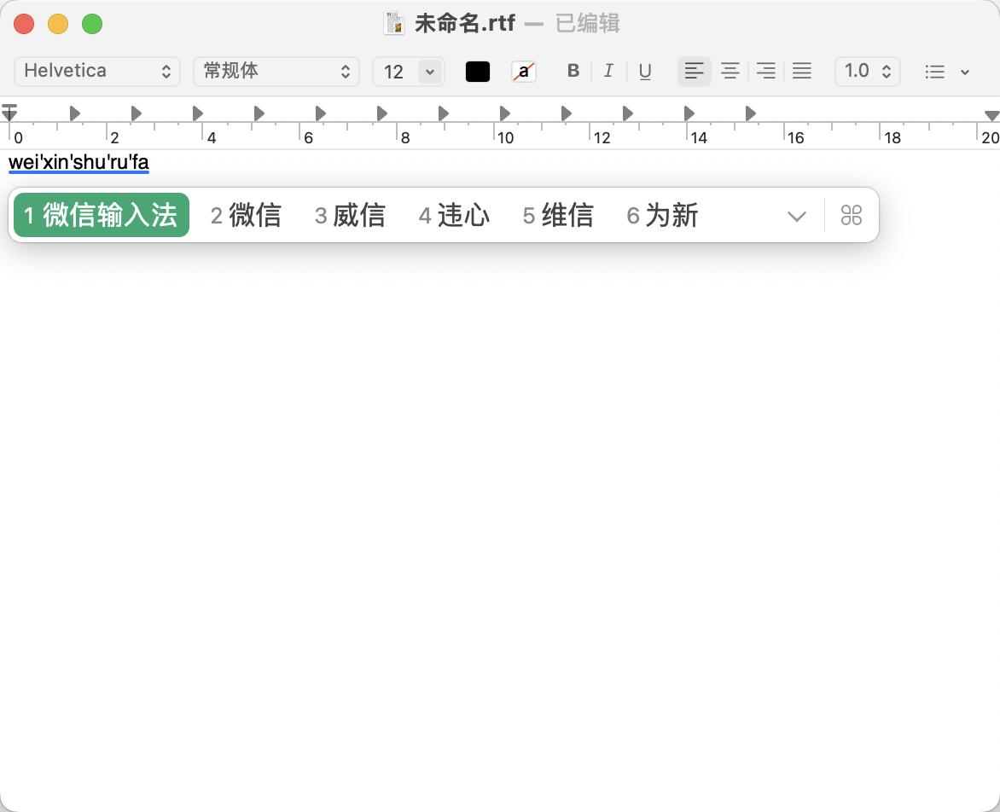

# WeType Touch Bar Bridge

**让微信输入法（WeType）在配备 Touch Bar 的 MacBook Pro 上获得接近 macOS 原生拼音输入法的候选词体验。**

这是一款轻量级 macOS 菜单栏辅助程序：在微信输入法输入拼音时，将候选词实时同步到 Touch Bar，支持直接触摸选词。

> 本项目为独立社区作品，与腾讯、微信及 Apple 无官方关联。当前已在一台 **2018 款 Intel MacBook Pro（macOS Sequoia）** 上完成实际使用测试；并非所有系统或输入法版本都已验证。

## 实机效果

### Touch Bar 候选词栏


### 在 macOS「文本编辑」中使用



上图来自项目实际运行截图，并非设计效果图。Touch Bar 候选词与微信输入法窗口中的候选词保持对应。

## 功能特性

- **实时同步候选词**：通过 macOS 辅助功能接口读取微信输入法候选窗口。
- **原生风格外观**：深蓝灰色连续背景、首选词高亮、圆角候选区域。
- **按文字实际宽度布局**：中文、英文和 Emoji 均可根据显示宽度分配空间。
- **候选词整体右对齐**：靠近右侧亮度、音量等系统控制区，同时保留系统 Control Strip。
- **横向滚动**：候选词过多时可以浏览后面的候选项。
- **触摸选词**：点击 Touch Bar 候选项，映射到微信输入法的候选编号执行选词。

> **响应延迟提示：** 本项目是独立于微信输入法的第三方辅助 App，并非输入法内置的 Touch Bar 组件。候选词需要通过 macOS 辅助功能接口读取并同步到 Touch Bar，触摸选词也需要通过模拟按键转交给输入法处理，因此在显示候选词和触摸上屏时可能存在一定延迟；实际体验会随系统负载、设备及输入法状态而变化。
- **性能诊断**：后台读取候选词并提供延迟分析日志。

## 运行环境

- 带实体 Touch Bar 的 MacBook Pro（目前在 2018 款 Intel 机型上验证）。
- macOS Sequoia 已实测；其他系统版本需要自行验证。
- 已安装并启用微信输入法（WeType），已知输入源标识：`com.tencent.inputmethod.wetype.pinyin`。
- 从源码编译需要 Xcode Command Line Tools（无需安装完整 Xcode）；直接下载预编译 App 则不需要。
- 在「系统设置 → 隐私与安全性 → 辅助功能」中授权本程序。

## 下载与安装（GitHub Releases）

**v1.0 正式版已发布！** 正式版本请优先前往 [GitHub Releases（最新版）](https://github.com/SDCOM-0415/WeTypeTouchBarBridge/releases/latest)，也可以在 [全部 Releases](https://github.com/SDCOM-0415/WeTypeTouchBarBridge/releases) 查看历史发布记录和更新说明。

| 设备架构 | 预期安装包名称 | 适用设备 |
| --- | --- | --- |
| Intel（x86_64） | `WeTypeTouchBarBridge-x86_64.zip` | Intel Touch Bar MacBook Pro |
| Apple Silicon（arm64） | `WeTypeTouchBarBridge-arm64.zip` | Apple Silicon Touch Bar MacBook Pro |

1. 打开 [Releases](https://github.com/SDCOM-0415/WeTypeTouchBarBridge/releases)，选择所需版本。
2. 在该 Release 的 **Assets** 中选择适合自己 Mac 架构的安装包（若发布者已附加）；注意 GitHub 自动生成的 **Source code** 压缩包仅包含源码，并非预编译 App。
3. 解压获得 `WeTypeTouchBarBridge.app`，建议移动到 `/Applications` 后启动。
4. 在「系统设置 → 隐私与安全性 → 辅助功能」中授予程序权限。输入拼音后，候选词会显示在 Touch Bar 上。
5. 需要登录时启动时，可在菜单栏「候1」中自行启用该选项。

如果某次 Release 尚未附上对应架构的预编译 ZIP，可在 [GitHub Actions 构建记录](https://github.com/SDCOM-0415/WeTypeTouchBarBridge/actions/workflows/build.yml) 找到成功运行的 `x86_64` / `arm64` Artifacts，或按下文自行从源码编译。Actions Artifact 的保留期限有限，下载可能需要登录 GitHub。

**安全与兼容性：** 当前构建使用 ad-hoc 签名，未进行 Apple Developer ID 签名及公证，macOS 可能拦截启动；请仅在核对并信任项目来源后运行，不建议全局关闭 Gatekeeper。Intel Touch Bar Mac 已有实机验证，arm64 目前仅完成 CI 构建测试，尚未在 Apple Silicon Touch Bar 设备上验证。

## 编译与启动

克隆仓库：

```bash
git clone https://github.com/SDCOM-0415/WeTypeTouchBarBridge.git
cd WeTypeTouchBarBridge
```

如尚未安装命令行开发工具：

```bash
xcode-select --install
```

构建并尝试启动：

```bash
chmod +x build.sh
./build.sh
```

编译产物位于：

```text
build/WeTypeTouchBarBridge.app
```

这是使用临时（ad-hoc）签名的实验性程序，**未经过 Apple 公证**。若 Finder 无法打开，可在确认并信任源码后从终端运行：

```bash
./build/WeTypeTouchBarBridge.app/Contents/MacOS/WeTypeTouchBarBridge
```

菜单栏出现「候1」表示辅助程序已启动。使用微信输入法输入拼音时，Touch Bar 会显示候选词。

### 安装位置选择（v1.0 起支持）

执行 `./build.sh` 后，脚本会交互式询问安装目标：

```text
1. 应用程序文件夹（/Applications，默认）
2. ./build
3. 自行输入目录
```

直接按回车选择选项 1。选项 3 支持绝对路径、以 `~/` 开头的用户目录路径以及相对于项目目录的路径。脚本始终先在 `./build` 编译和临时签名，再复制 App 到所选位置并尝试运行。

建议选择 `/Applications`，避免移动已登记登录项的 App。已存在的同名应用仅在其 Bundle Identifier 与本项目一致时才会被替换；修改安装位置后应重新检查辅助功能及登录项授权。

### 登录时自动启动（v1.0 起支持）

在菜单栏点击「候1」→「登录时启动」，程序使用 macOS 13+ 提供的 `SMAppService.mainAppService` 申请将当前 App 注册为登录项。

- 系统可能要求到「系统设置 → 通用 → 登录项与扩展」批准；你可以从菜单中的「打开登录项设置…」跳转。
- 再次点击「登录时启动」可尝试取消注册。
- 此设置只在用户主动操作时请求，不会在安装过程中悄悄开启。
- 建议把 App 固定放在 `/Applications` 后再注册，之后不要随意移动或更名。

**注意：** 自启动授权与辅助功能授权彼此独立。两者都可能需要你手动在系统设置中批准。

不建议为了启动本程序而全局关闭 macOS Gatekeeper。

## 工作原理

1. 检测微信输入法进程与输入源。
2. 使用 `AXUIElement` 查询候选词窗口中的文本。
3. 后台采样候选变化，并在主线程更新 Touch Bar。
4. 通过 AppKit `NSScrubber` 绘制可滚动、动态宽度且右对齐的候选栏。
5. 将用户触摸的候选项映射为微信输入法对应的数字选词操作。

项目**不修改微信输入法安装包**，也不注入其进程。

## 已知限制与安全说明

- **使用了 Apple 未公开的 Touch Bar 系统模态接口**，系统更新可能导致显示功能失效。
- 依赖微信输入法辅助功能树的结构和候选编号，微信输入法升级后可能需要适配。
- 触摸选词通过模拟数字键完成，不保证兼容所有输入场景。
- 由于第三方跨进程读取、刷新和按键转发机制，候选词显示及触摸选词可能比输入法原生集成方案略有延迟，无法保证完全实时。
- 辅助功能权限可能读取到正在输入的文字，请仅在信任本项目源码时授权，分享诊断日志前请检查隐私内容。
- 项目已发布 GitHub Release；预编译构建采用 ad-hoc 签名、未经过 Apple 公证，也未做广泛机型验证。
- 候选栏是对 Apple 原生体验的复刻，并非系统自带输入法内部组件。

## 项目文件

| 文件 | 用途 |
| --- | --- |
| `main.m` | Objective-C / AppKit 主程序 |
| `build.sh` | 一键构建与签名脚本 |
| `Info.plist` | 应用包配置 |
| `.github/workflows/build.yml` | 双架构 GitHub Actions 自动构建工作流 |
| `docs/` | 实际运行截图 |
| `LICENSE` | GNU GPLv3 开源许可证 |

## 许可证

本项目当前维护的代码采用 [GNU General Public License v3.0（GPL-3.0）](LICENSE) 授权。GPLv3 允许商业使用，但要求分发修改后的受保护程序时遵守相应的源码提供及相同许可证等义务。
